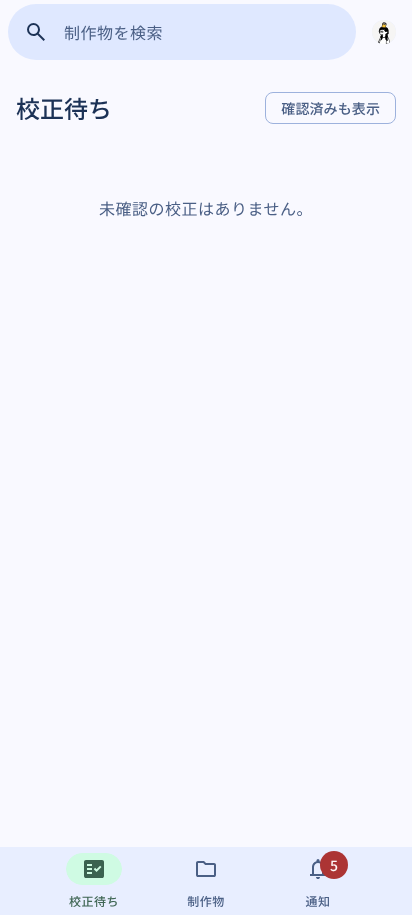

# 画面一覧（デモモードで撮影）

`apps/web` の**デモモード**（`pnpm build:demo` → `vp preview --mode demo`、バックエンド無しで Convex の実関数を `convex-test` によりブラウザ内実行）で、Nogiku モック委員 5 名を切り替えながら「登録済み制作物 → 版提出（専門確認の宣言） → 割当 → 指摘 → 専門確認完了 → 採否 → 第2版提出と指摘の持越 → 版比較 → 校了 → 通知」を一周して撮影した（v1 機能を含む）。撮影スクリプト: `apps/web/e2e/screenshots.mjs`（`pnpm screenshots`）。

画面構成は 2026-10-13 の利用者選択（[`UI_M3E.md`](UI_M3E.md) §10）に従う: 左メニュー＋検索バー＋右上アカウント、一覧は 2 行のリスト、制作物は左一覧・右中身、校正画面は下部のフローティングツールバーとレイアウト切替。

| #   | 画面（要件 §4）                                                        | 役割           | 画像                                              |
| --- | ---------------------------------------------------------------------- | -------------- | ------------------------------------------------- |
| 1   | サインイン（Nogiku SSO / 開発用モック）                                | —              |                     |
| 2   | U-02 制作物（左に一覧、右は未選択）                                    | 制作者         |                 |
| 3   | U-03 制作物詳細（版未提出・右に基本情報）                              | 制作者         |          |
| 4   | U-04 版提出ダイアログ: 全ファイル検証済み（確定前）                    | 制作者         |            |
| 5   | U-04 提出確定直後（その版の校正画面へ）                                | 制作者         |           |
| 6   | U-03 制作物詳細（最新版への導線・校正者割当後）                        | 主管           |  |
| 7   | U-01 自分の校正待ち（2 行のリスト）                                    | 校正者         |                      |
| 8   | U-05 校正画面: PDF をドラッグしてその場で投稿（横に一覧）              | 校正者         |          |
| 9   | U-06 指摘対応: ⋮ から理由付き不採用、履歴                              | 制作者         |                   |
| 10  | U-07 校了ダイアログ（対象版・未対応件数・例外理由）                    | 校了権限者     |            |
| 11  | U-03 校了後（校了版・校了履歴）                                        | 校了権限者     |             |
| 12  | U-08 作品の閲覧権限（個人 ACL）と変更履歴                              | システム管理者 |                        |
| 13  | U-08 管理（ACL 対象作品・ユーザー・監査ログ）                          | システム管理者 |                |
| 14  | v1 U-04 版提出: 専門確認の宣言と担当者選択（ダイアログ内）             | 制作者         |     |
| 15  | v1 制作物の編集（職責はユーザー選択 UI）                               | 主管           |                  |
| 16  | v1 U-05 専門確認（担当者が確認完了）                                   | 校正者         |        |
| 17  | v1 U-05 第2版: 前版の未解決指摘の持越（人が確認）                      | 制作者         |              |
| 18  | v1 アプリ内通知（依頼・割当・採否・持越）                              | 校正者         |              |
| 19  | v1 F-12 文章の閲覧と範囲指摘（本文を選択するとその場に投稿欄）         | 校正者         |                 |
| 20  | モバイル幅: 校正待ち（下部ナビゲーションバー・未読バッジ）             | 校正者         |               |
| 21  | 日付ピッカー（校正期限は日付のみ・0:00 JST）                           | 制作者         |                |
| 22  | アカウントメニュー（右上の Humation アバター）                         | 制作者         |               |
| 23  | U-05 レイアウト「ピンの高さに並べる」（Google ドキュメント式）         | 校正者         |             |
| 24  | U-05 レイアウト「ピンだけ」（Figma 式: 選択中のコメントをピンの横に）  | 校正者         |                |
| 25  | U-05 版の比較（第1版と第2版を並べ、ページ・倍率を共有）                | 制作者         |                    |
| 26  | モバイル幅: 校正画面（ツールバーは上、コメントは下から引き出すシート） | 校正者         |           |

`pnpm a11y` で同じ経路に axe-core（WCAG 2.1 A/AA）を流し、`docs/a11y-report.json` に結果を書く（26 画面。残る指摘は M3E calendar 内部の 1 件のみ）。

Material 3 Expressive 適用前の画面は `docs/screenshots-before/`、前後比較と検証は [`UI_M3E.md`](UI_M3E.md)。
